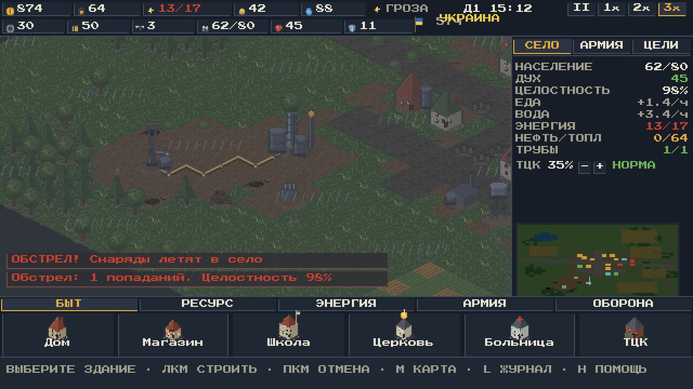
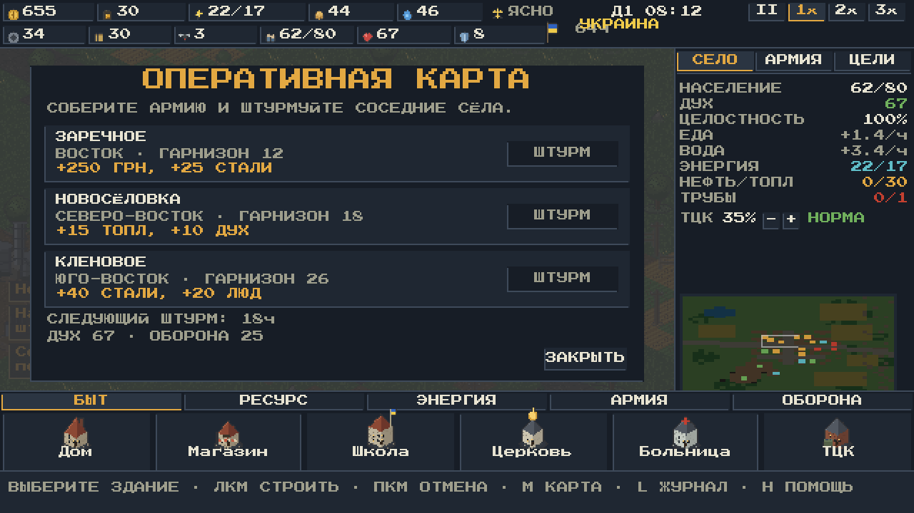

# СЕЛО ЗА 3 ДНЯ

Пиксельная изометрическая стратегия об обороне прифронтового села. У вас есть 72 игровых часа, чтобы наладить экономику, собрать армию и удержать село до подхода подкреплений.



## Скачать

Готовый `.exe` для Windows лежит в [Releases](../../releases/latest). Распакуйте архив и запустите `selo-za-3-dnya.exe`. Установка не нужна.

## Об игре

Вы принимаете небольшое село в нескольких километрах от фронта. Дома, огороды, старая нефтяная вышка и небольшой НПЗ — всё, что осталось. Дальше решают трубы, генераторы, очередь в ТЦК и то, успеете ли вы построить ПВО до первого «Шахеда».

- **2,5D изометрия** в пиксельном стиле, виртуальное разрешение 640×360 с целочисленным масштабированием.
- **Две стороны**: Украина — сильный дух, дроны и ПВО, средняя сложность. Россия — слабая армия, задержки поставок, коррупция и высокая сложность.
- **72 часа** до конца обороны. Время можно ускорить в 2 или 3 раза.
- **Три соседних села**, занятых противником. Их можно освободить, собрав отряд и нанеся удар.



## Экономика

Все цепочки замкнуты, промежуточные ресурсы видны в верхней панели.

| Цепочка | Как работает |
| --- | --- |
| Нефть → топливо | Вышка на нефтяной жиле → трубы → НПЗ. Без трубы вышка не качает, без питания НПЗ работает вполсилы. |
| Электричество | Дизель-генератор, ТЭС и солнечные панели дают мощность. Подстанция расширяет зону покрытия. Потребители вне зоны или при дефиците мощности не работают. |
| Еда и вода | Фермы кормят село, водонапорная башня даёт воду. Голод и жажда бьют по духу и населению. |
| Деньги | Налоги с населения, продажа топлива, конвои и награды за освобождённые сёла. |
| Сталь и БК | Металлоцех производит сталь, закупка БК идёт за деньги. Топливо, сталь и БК расходуются на технику и штурмы. |
| Люди | Дома повышают предел населения. Казарма пополняет пехоту, но тратит людей и БК. |

**ТЦК.** Ползунок мобилизации в панели «Село» регулирует приток резерва. Чем выше мобилизация, тем больше людей и тем сильнее падает дух: после 65% люди начинают бояться и уезжать.

**Дух села** зависит от церкви, школы, больницы, магазина, штаба, питания, воды, света и обстрелов. Низкий дух останавливает рост населения и ослабляет оборону.

## Оборона

- **Секторы**: север, центр, юг. Выберите направление в панели «Армия» — на нём армия дерётся в полную силу. Без выбранного сектора оборона растянута.
- **Обстрелы**: предупреждение за 0,9 часа, затем прилёты. Радар позволяет бить по батарее контрбатарейной борьбой.
- **Дроны и «Шахеды»**: ПВО, РЭБ и погода влияют на перехват. FPV-вылет и глубокий удар ослабляют следующую волну.
- **Штурмы**: раз в несколько часов враг идёт в атаку. Оборона складывается из армии, укреплений, снабжения и духа.
- **Укрепления**: окопы, бункеры, мины, ПВО, РЭБ и радар.
- **Производство**: казарма даёт пехоту, танковый завод — танки, ангар — дроны. Ремонтная база латает повреждённые здания.

Победа — выстоять 72 часа или освободить все три села. Поражение — потерять штаб, опустить население ниже 40 или дух до нуля.

## Управление

| Клавиша | Действие |
| --- | --- |
| WASD / стрелки | Двигать камеру |
| Колесо мыши | Приближение |
| ЛКМ | Построить или выбрать здание |
| ПКМ / Esc | Отменить стройку или выделение |
| 1–5 | Категории строительства |
| Tab | Панель справа: село / армия / цели |
| M | Оперативная карта соседних сёл |
| L | Журнал событий |
| H / F1 | Помощь |
| Пробел / P | Пауза |
| F12 | Скриншот |

Трубы тянутся перетаскиванием ЛКМ: выберите «Трубу» и ведите от вышки к НПЗ.

## Сборка из исходников

Нужен Rust 1.80+ и Windows/Linux/macOS с поддержкой OpenGL.

```bash
cargo run --release
```

Или соберите exe:

```bash
cargo build --release
```

Готовый файл появится в `target/release/selo-za-3-dnya.exe`. Шрифт Press Start 2P распространяется по лицензии SIL OFL 1.1 (см. `assets/OFL.txt`).

## Технологии

Rust, [macroquad](https://macroquad.rs). Вся графика запечена в один атлас из кода, звук не используется. Игра оптимизирована под слабые машины: фиксированное виртуальное разрешение и одна текстура атласа.

## Лицензия

Код — MIT (см. `LICENSE`). Шрифт — SIL OFL 1.1.

---

Село Соколовка и все события вымышлены. Это игровая стратегия, а не реконструкция реальных событий.
